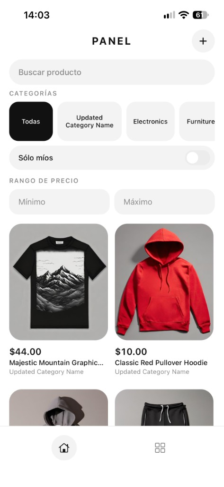
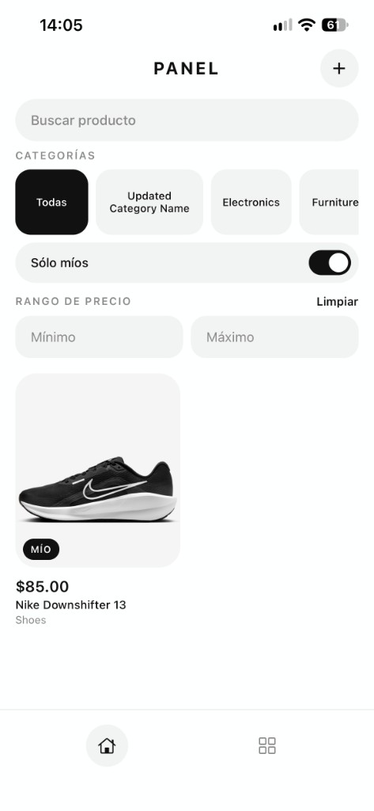
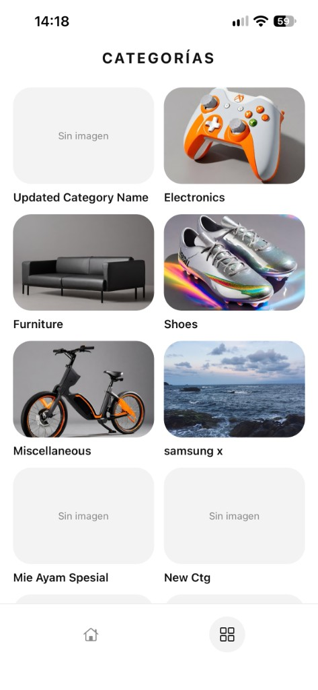
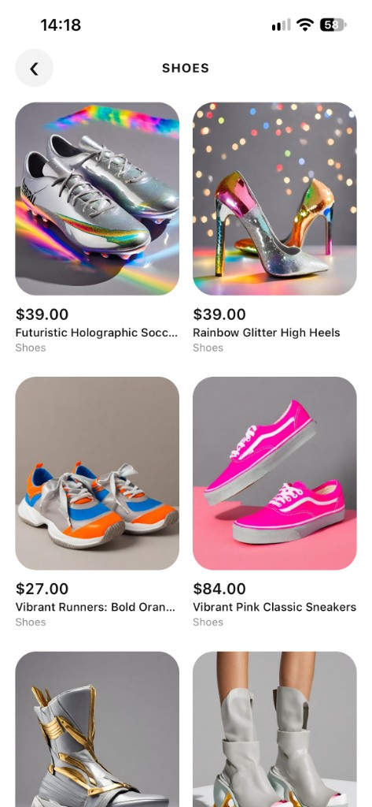
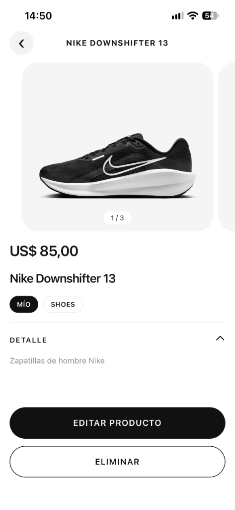
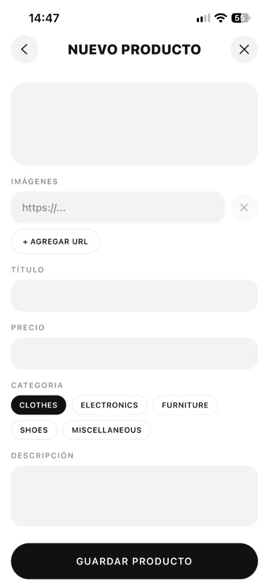
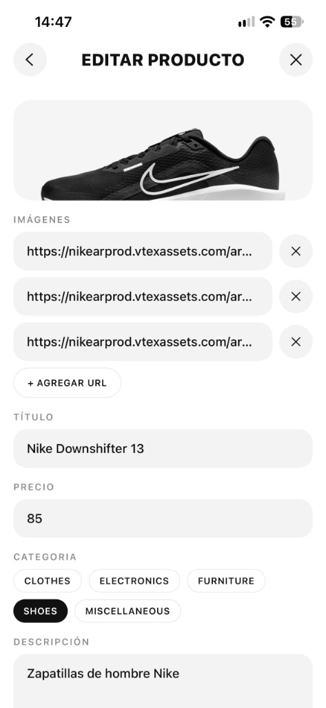
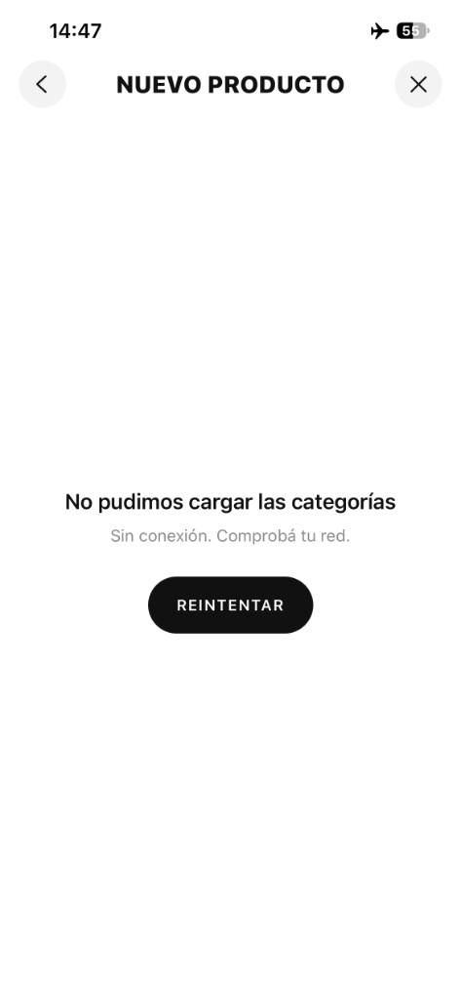

# Panel admin — Catálogo Platzi

TP Final · Unidad 5 · Ingeniería de Software II — IES Santa Fe (N° 9233)

**Propuesta elegida:** Propuesta 4 — Panel de administración de catálogo sobre la [Platzi Fake Store API](https://fakeapi.platzi.com).

App móvil (Expo + Expo Router + TypeScript) para recorrer productos con filtros y paginación, verlos por categoría y crear, editar y eliminar productos del grupo. Todo producto que creamos lleva el prefijo `**[G3]**` en el título; Editar y Eliminar solo aparecen en esos productos.

## Integrantes

- Lucas Díaz
- Felipe Florio
- Matias Vallejos
- Luciano Lopez

## Cómo ejecutarlo

Requisitos: Node.js 20 o superior y la app **Expo Go** (compatible con SDK 58) en el celular.

```bash
git clone https://github.com/Lucasdiaz-dev/panel-admin.git
cd panel-admin
npm install
npx expo start
```

Escaneá el QR con Expo Go (Android) o con la cámara (iOS). El celular y la compu tienen que estar en la misma red; si no, usá `npx expo start --tunnel`.

Chequeos:

```bash
npx tsc --noEmit
npx expo lint
```

La API es pública y se reinicia cada tanto: los productos creados pueden desaparecer sin que sea un error de la app.

## Capturas

Capturas tomadas en iPhone con Expo Go.

| 1. Productos                                | 1. Productos — "Sólo míos"                                                    | 2. Categorías                                  |
| ------------------------------------------- | ----------------------------------------------------------------------------- | ---------------------------------------------- |
|  |  |  |

| 3. Productos por categoría                                         | 4. Detalle de producto                                      |
| ------------------------------------------------------------------ | ----------------------------------------------------------- |
|  |  |

| 5. Alta                                             | 5. Edición (varias URLs precargadas)                  | 5. Alta sin conexión                                                          |
| --------------------------------------------------- | ----------------------------------------------------- | ----------------------------------------------------------------------------- |
|  |  |  |

## Estructura de carpetas

```
src/app/         pantallas y layouts (Expo Router): (tabs) Productos y Categorías, category/[id], product/[id], product/new, product/edit/[id]
src/components/  componentes reutilizables con props tipadas: ProductCard, ProductForm, Filters, ImageCarousel, ErrorMessage, Loading, FormHeader, TabBarIcon
src/services/    toda la comunicación HTTP: http.ts (fetch, res.ok y mensaje de error del servidor), products.ts, categories.ts
src/types/       Product (lo que se lee, con category objeto) y ProductInput (lo que se envía, con categoryId)
src/constants/   colores, URL base de la API y prefijo del grupo en un solo lugar
docs/            diseño (design.md, ui-preview.html) y bitácora de IA (ia.md)
```

Las pantallas no llaman a `fetch`: piden los datos a `services/`, que verifica `res.ok` y lanza el `message` que devuelve la API. Después de crear, editar o eliminar, las pantallas vuelven a pedir los datos con `useFocusEffect` en lugar de modificar listas locales.

## Uso de IA

### Herramientas

- **Cursor** (agente con modelos Claude) para generar, integrar y revisar código dentro del proyecto.
- **ChatGPT** para consultas, generación de código y resolución de dudas durante el desarrollo.
- Documentación oficial de Expo SDK 58 para verificar las APIs que proponía la IA antes de usarlas.

### Prompts más importantes

1. "Implementá la lista de productos con paginación offset/limit, filtros de texto, precio y categoría, y el interruptor 'Sólo míos'. Si cambia un filtro, la paginación vuelve a 0 y se reemplaza la lista. Respetá `AGENTS.md`."
2. "Implementá el detalle de producto según la segunda pantalla de `docs/ui-preview.html`: carrusel de imágenes con placeholder, precio, categoría tocable y descripción. Editar y Eliminar solo si el título tiene el prefijo del grupo."
3. "Armá un único `ProductForm` para alta y edición. El form no muestra el prefijo; `services/` lo agrega en POST/PUT solo si falta. El body usa `ProductInput` con `categoryId`."
4. "Hidratá las pills de categoría del formulario con `getCategories()` y el tipo `Category` de la API."
5. "Agregá validación al formulario: título, precio numérico ≥ 0, descripción, categoría y al menos una URL, con el error debajo de cada campo. Después de guardar o eliminar mostrá un aviso y volvé a una pantalla coherente."
6. "Reemplazá el input de imagen por una lista de URLs con '+ Agregar URL' (mínimo una, todas `https://`). Si fallan las categorías o el producto en alta/edición, mostrá `ErrorMessage` con Reintentar. Agregá `ActivityIndicator` al cargar, guardar, borrar y al pie de la lista."

### Errores de la IA y cómo los corregimos

**1. `useFocusEffect` importado del paquete equivocado.** La IA lo importó desde `@react-navigation/native`. Ese paquete no estaba instalado y, al instalarlo, la app mostró `Couldn't find a navigation object` porque creaba un contexto de navegación separado. Lo corregimos verificando la documentación de Expo Router 58, importando `useFocusEffect` desde `expo-router` y quitando la dependencia.

**2. Botón Reintentar que no reintentaba.** La IA hizo que `Reintentar` solo incrementara un estado auxiliar, esperando que `useFocusEffect` volviera a correr. Con la conexión recuperada, el botón no hacía ninguna petición nueva. Lo corregimos extrayendo la carga a una función que se llama tanto al enfocar la pantalla como al tocar `Reintentar`, e ignorando respuestas de pedidos anteriores.

**3. Formulario sin validación.** El `ProductForm` generado mandaba el POST/PUT con campos vacíos o precio no numérico y dependía del 400 del servidor, cuando la consigna (R5) pide validar antes de enviar. Agregamos validación de título, precio, descripción, categoría y URL `https://`, con el mensaje debajo de cada campo.

**4. Categorías sucias en el selector.** La IA mostró todas las categorías del endpoint público, que incluye decenas de nombres de prueba (`Electronics from Config-<uuid>`, sufijos aleatorios). Normalizamos los nombres, descartamos los de prueba y deduplicamos; el body sigue enviando `categoryId`.

**5. Error de carga mezclado con el de guardado.** Alta y edición usaban un solo estado `error` para las dos cosas. Si fallaban las categorías, el mensaje quedaba al pie del formulario, sin Reintentar, y Guardar terminaba en "Elegí una categoría". Separamos los estados y, cuando falla la carga, se muestra `ErrorMessage` con un Reintentar que vuelve a pedir los datos.

Más detalle de cada caso en [`docs/ia.md`](docs/ia.md).
